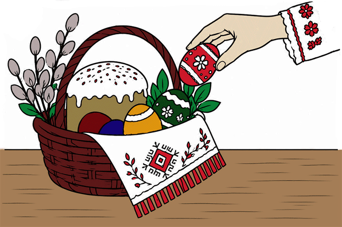

# Великдень на Вінниччині

Готовий статичний сайт: 5 сторінок, адаптивне меню, каруселі, збільшення зображень.

## Як відкрити
В IntelliJ IDEA: File → Open → папка VelykdenVinnychyna. Відкрийте index.html у браузері.

## Зображення
У папку images додайте експортовані оригінали **без панелей Photoshop/Illustrator** з такими назвами:

- `easter-table.webp` — table
- `easter-bell.webp` — bell
- `vinnytsia-map.png` — map
- `logo.png` — logo
- `floral-pysanka.webp` — egg
- `pysanky-still-life.webp` — pysanky
- `easter-family.webp` — family
- `church-and-eggs.webp` — church
- `easter-basket-guide.webp` — basket
- `church-basket-illustration.webp` — vector
- `candle-eggs.webp` — candle
- `easter-animation.gif` — gif

Рекомендовано: фотографії та ілюстрації WebP, прозорі логотип і карта PNG (або SVG після коректного експорту). Кодування назв — латиниця. Фото зазвичай 1200–1600 px по ширині; підбирайте якість WebP 70–85 та перевіряйте читабельність. Логотип можна оптимізувати до 150–250 px по ширині. Для GIF залишено місце на сторінці traditions.html; після підготовки замініть вміст блоку .gif-slot на .

Якщо файл зображення відсутній, сайт показує декоративну заглушку. Це тимчасово: потрібно замінити її реальним зображенням перед здачею.

Шрифти Playfair Display та Manrope завантажуються з Google Fonts. Для повністю офлайн-версії можна замінити їх системними.
